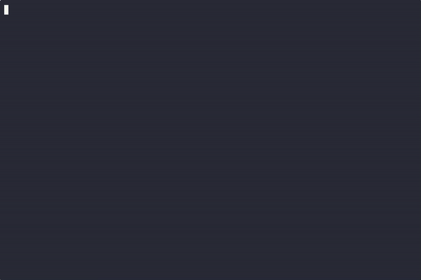
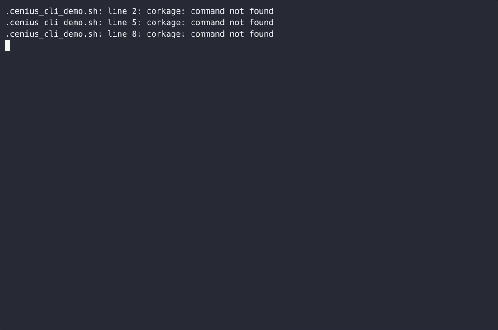

# Corkage — complete Full-stack app command-line tool example app

This repository contains the complete source for **Corkage**, an open-source command-line tool built with Full-stack app. Corkage is a single-file, standard-library-only Python command-line tool that logs wine bottle cork condition and extraction notes, records cellar temperature and humidity readings, and generates cork-soak and decant…. Everything Corkage needs to run is here — code, seed data, install scripts. Apache-2.0-licensed — use Corkage commercially, self-host it, or [remix Corkage on cenius.ai](https://cenius.ai/marketplace/p/corkage?ref=gh&utm_campaign=corkage-webapp) to make it yours.


[](LICENSE)  [](https://cenius.ai)

[](https://cenius.ai/marketplace/p/corkage?ref=gh&utm_campaign=corkage-webapp)

> **▶ [Open & edit in cenius.ai](https://cenius.ai/marketplace/p/corkage?ref=gh&utm_campaign=corkage-webapp)** — one click to an editable workspace: describe changes in plain English, get an instant preview, one-click deploy and host. Modifications made on the platform come with full rebrand & relicense rights.

_Local clone? See [Quick start](#quick-start) below. cenius.ai is the zero-setup path._

## Demo



▶ **[Watch the full demo video](https://cenius.ai/marketplace/p/corkage?ref=gh&utm_campaign=corkage-webapp)** — the complete walkthrough, playing on the project's cenius.ai page · [MP4 file](.github/media/demo.mp4)

## Screenshots



## Features

- Cork condition and extraction notes log
- Cellar temperature and humidity readings
- Cork soak and decant reminders

## Architecture

Folder layout: `tests/`. The setup script (`install.sh`) installs runtime dependencies and loads a starter dataset so the app is immediately usable. Built in Full-stack app (21 files). Full setup details: [`INSTALL.md`](INSTALL.md).

## Quick start

```bash
./install.sh   # installs dependencies + seeds demo data
```

See [`INSTALL.md`](INSTALL.md) for full setup and usage instructions.

## Usage guide

Everything below is copy-pasteable. `CORKAGE_PASSPHRASE` is used in the examples so
you can see the output; omit it to be prompted instead (hidden on a terminal).

```bash
export CORKAGE_HOME="$HOME/cellar-demo"
export CORKAGE_PASSPHRASE="cellar-pass"
python3 corkage.py init
```

### Log a cork and read the log

```bash
$ python3 corkage.py cork add --bottle "Barolo 2016" --condition soaked \
      --note "stained halfway up, slid out clean"
logged cork #1 for Barolo 2016 (soaked)
decant reminder #1 for Barolo 2016 due 2026-11-13 (auto: soaked cork)

$ python3 corkage.py cork add --bottle "Rioja Reserva 2012" --condition sound \
      --note "snug fit, firm and dry"
logged cork #2 for Rioja Reserva 2012 (sound)

$ python3 corkage.py cork list
ID  BOTTLE               CONDITION  EXTRACTION NOTE                     LOGGED (UTC)
-------------------------------------------------------------------------------
2   Rioja Reserva 2012   sound      snug fit, firm and dry              2026-10-14 19:31 UTC
1   Barolo 2016          soaked     stained halfway up, slid out clean  2026-10-14 19:30 UTC
```

The log is newest first. Conditions are `sound`, `soaked`, `crumbly` and `moldy`,
matched case-insensitively; anything else is refused with one line naming the
allowed values and exit code 2, and the log stays untouched.

With no entries yet:

```bash
$ python3 corkage.py cork list
No cork entries yet - add one with: corkage cork add --bottle NAME --condition sound
```

### Record the cellar climate

_Full guide: [`USAGE.md`](USAGE.md)_

## FAQ

### How do I get Corkage running locally?

Grab the repo and run `./install.sh` — it handles packages and seed data in one go. After that, [`INSTALL.md`](INSTALL.md) walks you through starting the server. No external accounts required.

### What license does Corkage use?

Confirmed free for commercial use — MIT terms let you incorporate, resell, or ship it in any product. [LICENSE](LICENSE).

### Which framework or language does Corkage use?

Powered by Full-stack app. This repo is the real thing — full source, seed data, and all — ready to clone and start up. Highlights include cork soak and decant reminders.

### What if I want to add features to Corkage without coding?

Open it on [cenius.ai](https://cenius.ai/marketplace/p/corkage?ref=gh&utm_campaign=corkage-webapp) and describe the changes you want in plain English — the platform modifies the app and gives you a new, downloadable build.

### How do I make Corkage my own brand?

Yes. The MIT license lets you remove the original branding and ship under your own name. For a guided approach, [remix it on cenius.ai](https://cenius.ai/marketplace/p/corkage?ref=gh&utm_campaign=corkage-webapp): you get a fresh build with full rebrand and relicense rights.

## License & rebranding

Released under the [Apache License 2.0](LICENSE) (© 2026 Cenius AI) — free for personal and commercial use. The Cenius name/logo are trademarks (see NOTICE).

**Need a customized version?** [Remix this app on cenius.ai](https://cenius.ai/marketplace/p/corkage?ref=gh&utm_campaign=corkage-webapp) — modifications made on the platform come with **full rebrand & relicense rights** over your derivative.

## Built with cenius.ai

This entire application — code, design, seeded demo data — was generated on **[cenius.ai](https://cenius.ai)** from a plain-English description.

- 🚀 [Build your own app on cenius.ai](https://cenius.ai)
- 🎛️ [Remix Corkage on the marketplace](https://cenius.ai/marketplace/p/corkage?ref=gh&utm_campaign=corkage-webapp) — open it in a workspace, prompt for changes, and ship your own version.

More open-source apps: [the Cenius-ai catalog](https://github.com/Cenius-ai) · [showcase index](https://github.com/Cenius-ai/showcase)
